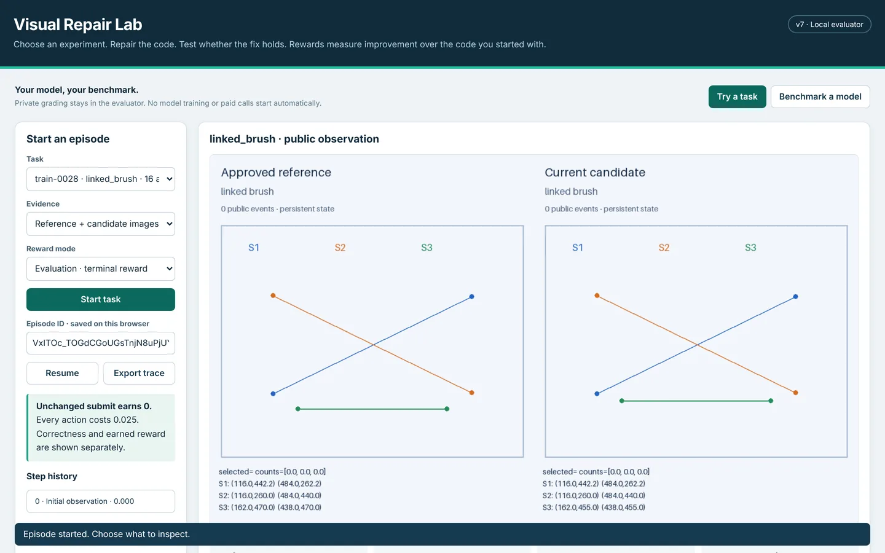

# Visual Repair Lab

[](https://github.com/tusu18/visual-repair-lab/actions/workflows/tests.yml)
[](https://tusu18.github.io/visual-repair-lab/)


**An RL environment and benchmark for AI agents that debug interactive visual software.** The agent compares an approved reference with a buggy candidate, chooses its own experiments, edits Python, activates and tests the edit, then submits to a protected grader that checks behavior across states the agent may never have tried.

**Explainer site with real frames, a reward calculator and results: https://tusu18.github.io/visual-repair-lab/**



## Why

A coding agent can make the current screen look right and still leave the software wrong. Visual Repair Lab measures the whole repair loop: find the cause, fix it, and choose a test that could expose an incomplete fix.

## How an episode works

`observe` → `interact` (drag, zoom, brush, advance physics) → `edit` (saves a revision) → `run` (activates it) → test again → `submit` (protected grade, episode ends)

- The actor receives the rendered reference and candidate, public state and history, saved and active code, controls with valid ranges, and its remaining budget.
- Hidden rules, reference programs, grading cases and reward ledgers stay inside the evaluator, behind an HTTP boundary.
- Grading compares structured outputs with an independent reference (absolute tolerance 1e-6, relative 1e-9), not screenshots.

| Family | Tasks | What the agent investigates |
|---|---:|---|
| Drag | 33 | Pointer capture, layout thresholds, pointer scaling, conditional drawing |
| Chart & brush | 63 | Shared transforms, projection, clipping, linked selection |
| Contact dynamics | 38 | Integration order, limits, collisions, contact state |
| Detection overlay | held out | Padding, confidence cutoffs, suppression, labels, clipping |

The release generator proposed 200 tasks and admitted 134 (67%) after certification: source parity, reference agreement, at least two omission witnesses per hidden rule, control-contract compatibility and observable behavior.

## Reward (v7, `relative-start-v1`)

With S the starting code's passed checks, F the submitted code's and N the total:

- F = S: **0** (unchanged behavior earns nothing)
- F > S: **8 × (F − S) / (N − S)**, plus **2** for a full repair
- F < S: **−2 × (S − F) / N**
- Costs: −0.025 per action, −0.1 per invalid action, −0.25 for submitting unactivated code, −2 for exhausting the budget without submitting

The previous formula paid unchanged code a positive return on 89 of 134 tasks; v7 pays zero on all 134. Train mode adds bounded process signals (progress, test power, verification, comparison, prediction; caps sum to 2.0). See [`docs/REWARD_V7.md`](../docs/REWARD_V7.md).

## Results so far

Seven-profile development comparison (October 30, 2026): 63 attempts on nine shared tasks, 60 submissions, 3 full repairs, all 63 trajectories replayed exactly (1,269 actions).

| Profile | Full repairs | Mean submitted checks | Mean return |
|---|---:|---:|---:|
| GPT-6 Astra | 2/9 | 72.4% | 4.081 |
| Gemini 4 Argon | 1/9 | 66.5% | 3.173 |
| Sonnet 5.5 | 0/9 | 44.7% | 1.318 |
| GPT-6 Sol | 0/9 | 36.6% | 0.333 |
| Muse Glimmer 30B | 0/9 | 30.0% | −0.552 |
| Nemotron 3.5 VL | 0/9 | 34.7% | −1.956 |
| Qwen3.8 27B | 0/9 | 33.1% | −2.354 |

The earlier v6 baseline (360 trajectories on 120 shared worlds) found GPT 6.1 Sol at 20.8% full repairs (95% CI 14.5–28.9), GPT 6.1 Terra at 6.7% and GPT 5.6 Sol at 5.0%. These are development-data results under specific interfaces and inference settings, not a general model ranking.

## Quickstart

Python 3.11–3.13 on macOS or Linux. No API key or GPU is needed for the evaluator.

```sh
bash scripts/install.sh
bash scripts/start_lab.sh        # open http://127.0.0.1:8822/
# or: docker compose up --build
```

Run the checks:

```sh
.venv/bin/python -m pip install -r requirements-test.lock
.venv/bin/python scripts/run_tests.py --output validation/local --timeout 420
.venv/bin/python scripts/validate_v7.py
```

307/307 tests pass on macOS arm64 (Python 3.13), Linux arm64 (3.12) and Linux x86_64 (3.13). To benchmark a model, open **Benchmark a model** in the GUI and point it at a local OpenAI-compatible image-input endpoint. For programmatic use: `visual_repair_lab.make_env(spec=...)` or Gym ID `VisualRepairDelivery-v7`.

Keep the evaluator, banks and databases out of the model's filesystem; the actor should talk to the public HTTP endpoint only. The restricted interpreter is a research control, not an OS sandbox.

## Repository layout

| Path | Contents |
|---|---|
| `visual_repair_lab/` | v7 server, GUI, benchmark runner, adaptive generator and curriculum |
| `vision_sort/` | Task families, runtimes, rendering, mutants and historical environments |
| `banks/` | The 134-task development bank and its certification records |
| `actor_client/` | Actor-side HTTP client and restricted runner |
| `tests/`, `validation/` | 307 tests and release receipts (tests, concurrency, reward audit) |
| `docs/` | Specifications, user guide, limitations, and the explainer site |

Release notes for v7 are in the root [`README.md`](../README.md) and [`DELIVERY_REPORT.md`](../DELIVERY_REPORT.md).

## Limits

No model weights were trained, so the benefit of training on these tasks is not established. The bundled tasks are public development data, not a private holdout. Finite reference-parity and adversarial tests do not prove the grader cannot be gamed. Details: [`docs/LIMITATIONS_V7.md`](../docs/LIMITATIONS_V7.md).

## License

MIT. Built by [Tushar Singh](https://tusu18.github.io/portfolio).
